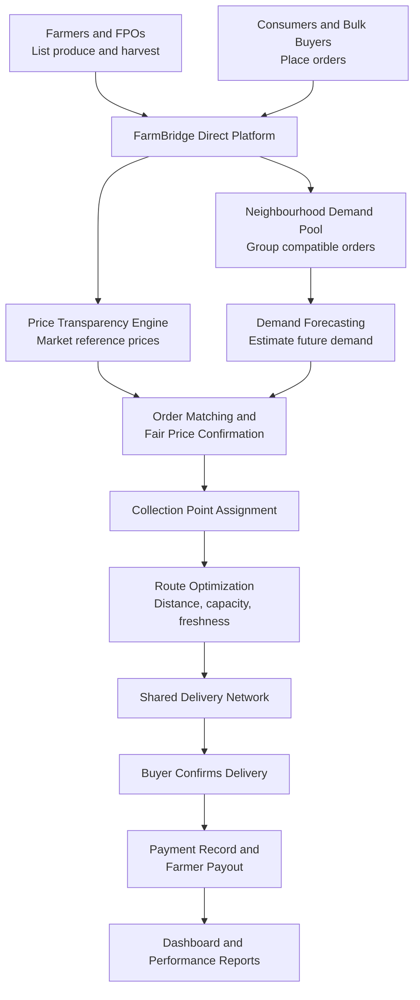

# Smart India Hackathon Workshop

**Project Name:** FarmBridge Direct  
**Date:** 28 October 2026  
**Reference Number:** 26017367
**Name:** S PRASANA

## Problem Title

**SIH 26033: Multiple intermediaries reduce farmers' earnings and increase consumer prices.**

## Problem Creator's Organization

Ministry of Consumer Affairs, Food & Public Distribution

## Theme

Agriculture, FoodTech & Rural Development

---

# 1. Problem Description

Agricultural produce often passes through several intermediaries before reaching the final consumer. Each additional stage can add handling, transportation, storage, and trading costs, while farmers may have limited access to buyers and reliable market-price information.

Small farmers may also struggle to transport small quantities economically, while retailers and consumers face difficulties sourcing fresh produce directly from farms.

The problem requires a digital marketplace that connects farmers and Farmer Producer Organisations (FPOs) directly with buyers, improves logistics, and uses demand forecasting and route optimization to reduce avoidable supply-chain costs.

---

# 2. Proposed Solution

## FarmBridge Direct — A Smart Farm-to-Buyer Marketplace

FarmBridge Direct is a digital agricultural marketplace that connects farmers and FPOs directly with households, retail shops, hotels, restaurants, and bulk buyers.

Its main innovation is a **Neighbourhood Demand Pool**, which combines compatible orders from nearby buyers so that farmers can sell larger quantities through fewer, more efficient deliveries.

### How the Solution Works

**1. Direct Farmer Registration**

Farmers and FPOs register on the platform and list their crops, available quantities, expected harvest dates, quality grades, locations, and selling prices.

**2. Transparent Price Comparison**

The system displays available offers alongside reference market prices from sources such as AGMARKNET and e-NAM, helping farmers and buyers make informed decisions.

**3. Neighbourhood Demand Pool**

Orders from nearby households, shops, and institutions are grouped by produce type, quantity, location, and preferred delivery window. This helps combine smaller orders into practical bulk shipments.

**4. AI-Based Demand Forecasting**

The system estimates upcoming demand using historical orders, seasonal patterns, current orders, and available harvest information. Farmers receive demand signals before dispatching their produce.

**5. Shared Logistics and Route Planning**

Orders are assigned to suitable collection points and delivery partners. Route optimization considers distance, vehicle capacity, delivery deadlines, and the freshness requirements of different crops.

**6. Transparent Transaction Record**

Buyers receive a breakdown of the produce price, logistics charge, platform fee, and total amount. Farmers can see the agreed selling price, deductions, and expected payout.

**7. Delivery and Feedback**

Buyers confirm receipt, report quality problems, and submit feedback. The platform records delivery status and payment details to improve trust and accountability.

### How It Addresses the Problem

FarmBridge Direct reduces dependence on unnecessary resale intermediaries by connecting producers with end buyers. Grouping nearby orders makes delivery more economical, while price transparency helps both parties negotiate fairly.

Better demand planning can reduce avoidable overproduction, unsold stock, and last-minute transportation.

### Innovation and Uniqueness

The solution combines three features into one workflow:

- **Neighbourhood Demand Pool:** Small orders from multiple buyers are combined into a practical shipment.
- **FairShare Price Card:** Every order clearly shows how much goes to the farmer and how much is charged for transportation and platform services.
- **Harvest-to-Order Matching:** Available or upcoming harvests are matched against predicted and confirmed demand before produce is dispatched.

Unlike a marketplace that only lists products, FarmBridge Direct connects demand aggregation, farmer earnings transparency, and logistics planning in the same process.

The design is a proposal; its uniqueness against other learners' submissions should be checked before submission.

---

# 3. Technical Approach

## Visual Overview

<table>
  <tr>
    <td align="center" width="33%">
      
       
      <strong>1. Digital Farmer Access</strong>
       
      Farmers register, list produce and manage orders.
    </td>
    <td align="center" width="33%">
      
       
      <strong>2. Produce Aggregation</strong>
       
      Orders are combined and produce is prepared for collection.
    </td>
    <td align="center" width="33%">
      
       
      <strong>3. Smart Route Planning</strong>
       
      Delivery routes are planned to reduce unnecessary travel.
    </td>
  </tr>
</table>

**Image credits:** [Pexels — Farmer using a smartphone](https://www.pexels.com/photo/man-using-smartphone-in-rice-field-outdoors-37687763/), [Phadke09 — Tomatoes ready for dispatch (CC BY-SA 4.0)](https://commons.wikimedia.org/wiki/File:Tomatos_ready_for_dispatch.jpg), and [Vehicle Routing Problem Solver — Route visualization (Apache-2.0 repository)](https://github.com/reinterpretcat/vrp).

*These images demonstrate relevant agricultural and logistics concepts; they do not represent a deployed FarmBridge Direct system.*

## Technologies to Be Used

| Component | Proposed Technology | Purpose |
|---|---|---|
| User Interface | HTML, CSS, JavaScript and React | Farmer, buyer and logistics dashboards |
| Backend | Python with Django or Django REST Framework | User management, listings, orders and business logic |
| Database | PostgreSQL | Store users, produce, prices, orders, delivery and payment records |
| Demand Forecasting | Python, Pandas and scikit-learn | Estimate demand using historical and seasonal data |
| Route Optimization | OpenStreetMap data with a routing engine such as OSRM | Plan practical pickup and delivery routes |
| Price Information | AGMARKNET/e-NAM data, subject to available access and integration permissions | Display reference prices for agricultural produce |
| Payments | UPI through an authorized payment integration | Support traceable digital payments |
| Deployment | Cloud hosting with HTTPS, database backups and role-based access | Provide secure access and reliable service |

These are proposed technologies for implementation. The initial prototype can use sample data and simulated payments. Real market-data integrations and payment processing can be introduced after the required access and permissions are arranged.

## Methodology and Implementation Process

### Step 1 — Registration

Create separate accounts for farmers, Farmer Producer Organisations (FPOs), consumers, bulk buyers and logistics partners.

### Step 2 — Produce Listing

Farmers enter crop details, available quantity, expected harvest date, location, quality grade and asking price.

### Step 3 — Buyer Ordering

Buyers search for produce, select quantities and specify their preferred delivery location and time window.

### Step 4 — Neighbourhood Order Aggregation

The platform groups compatible orders by produce type, location and delivery window. Smaller orders can be combined into practical bulk shipments.

### Step 5 — AI-Based Demand Forecasting

A forecasting module estimates future demand using historical orders, seasonal patterns and confirmed buyer requirements.

During the initial pilot, the system can use confirmed orders and seasonal averages. Machine-learning forecasts can be introduced when sufficient reliable data becomes available.

### Step 6 — Price and Order Matching

The platform compares farmer offers with buyer demand and displays a transparent cost breakdown, including produce price, logistics charges and applicable platform fees.

### Step 7 — Logistics and Route Optimization

The system assigns suitable collection points and delivery partners. Route planning considers distance, vehicle capacity, delivery deadlines and produce freshness requirements.

### Step 8 — Delivery and Settlement

Buyers confirm receipt of produce, delivery status is updated and transaction records are maintained. Farmers receive a clear statement of their agreed selling price and applicable deductions.

## Technical Approach Flowchart

The following diagram represents the proposed end-to-end workflow.

**Figure 1:** Proposed FarmBridge Direct technical workflow.

## System Architecture

The system consists of four major layers:

1. **Presentation Layer:** Provides responsive dashboards for farmers, buyers and logistics partners.
2. **Application Layer:** Handles registration, product listings, demand aggregation, order matching and transaction processing.
3. **Intelligence and Logistics Layer:** Forecasts demand, identifies compatible orders and calculates efficient delivery routes.
4. **Data Layer:** Stores user information, produce listings, market references, orders, delivery updates and payment records.

## Implementation Methodology

Development will proceed in stages:

1. Build registration, produce listings and buyer ordering.
2. Implement neighbourhood order aggregation and transparent price breakdowns.
3. Add basic demand forecasting and route optimization.
4. Test the system with sample farmers, buyers and orders.
5. Conduct a limited pilot with participating farmers or an FPO.
6. Measure farmer net earnings, buyer costs, delivery efficiency and food loss before expanding the platform.

---

# 4. Feasibility and Viability

## A. Technical Feasibility

The project can be developed using commonly available web technologies, a relational database, open-source data-processing tools, and existing mapping and routing technologies. Its initial version does not require specialized hardware.

A responsive website can support smartphones, tablets, and computers. Farmers who are unfamiliar with digital platforms can be assisted by FPO coordinators or local collection-centre operators.

The system can initially use manually entered market prices and a simple demand-prediction model. More advanced forecasting and automated integrations can be introduced after real usage data becomes available.

## B. Economic Viability

The platform can generate value by combining orders that would otherwise require separate trips and by reducing unnecessary resale stages. Its operating costs would include hosting, maintenance, customer support, order verification, and logistics coordination.

Potential revenue sources include:

- A small, clearly disclosed service fee on successfully completed orders.
- Optional paid inventory, analytics, and order-management tools for larger buyers or institutions.
- Logistics coordination services with charges disclosed before order confirmation.

The platform should not rely on hidden commissions or unrealistic price guarantees. Farmers and consumers should be able to view the financial breakdown before confirming a transaction.

## C. Potential Challenges and Mitigation Strategies

| Challenge | Proposed Mitigation |
|---|---|
| Limited digital literacy among farmers | Simple regional-language interface and assisted registration through FPOs |
| Unreliable demand forecasts at the beginning | Start with confirmed orders, seasonal averages and conservative forecasts |
| Produce spoilage and quality differences | Harvest-date records, basic quality grading, freshness-based delivery priorities and suitable storage |
| Low order volumes in some locations | Launch in selected local clusters and expand after building reliable demand |
| Buyer cancellations and delayed payments | Order confirmation rules, order-status tracking, clear cancellation policies and traceable payment records |
| Limited network or internet access | Low-bandwidth pages and assistance through local coordinators |
| Trust and disputes over quality or quantity | Digital receipts, quantity confirmation, buyer feedback, and a defined complaint-resolution process |

## D. Deployment and Scalability

The project should begin as a pilot in one selected agricultural cluster, working with a small group of farmers or an FPO, local retailers, and a logistics partner.

The pilot should test whether order pooling actually reduces delivery cost per kilogram, improves farmer earnings, and lowers the final buyer price.

After evaluating those results, the system can be extended to additional villages, crop categories, and buyer groups.

Integration with wider digital-commerce networks may provide a future expansion route, subject to technical and operational requirements. ONDC's network model provides a relevant reference for separating buyer applications, seller applications, and logistics functions.

**Overall Feasibility:** The proposal is technically achievable as a student prototype and can be piloted at a limited scale. Its long-term viability depends on attracting repeat buyers, building farmer trust, maintaining produce quality, and demonstrating measurable savings.

---

# 5. Impact and Benefits

## A. Potential Impact on the Target Audience

### Farmers and FPOs

- Direct access to more buyers.
- Better visibility of prevailing market prices.
- Clearer payout information.
- Opportunities to sell larger aggregated quantities.

### Consumers

- Potentially lower final prices.
- Fresher produce.
- Better visibility of product origin.
- More transparent delivery charges.

### Retailers, Hotels and Bulk Buyers

- Easier sourcing.
- Consolidated orders.
- Predictable availability.
- Reduced effort in coordinating purchases from multiple suppliers.

### Logistics Providers

- Better vehicle utilization.
- Coordinated collection schedules.
- Fewer avoidable trips.
- More efficient delivery planning.

### Rural Communities

- Greater access to digital commerce.
- Improved participation in agricultural markets.
- Opportunities for local collection-centre and delivery services.

## B. Social, Economic and Environmental Benefits

| Area | Expected Benefit |
|---|---|
| Economic | Higher farmer earnings through improved market access and fewer unnecessary resale stages |
| Consumer Welfare | Reduced final cost when savings are passed on to buyers |
| Supply-Chain Efficiency | Lower coordination costs through order pooling and shared delivery |
| Environmental | Potential reduction in fuel use and transport emissions per kilogram delivered |
| Food Security | Better demand planning and fewer avoidable losses from unsold or delayed produce |
| Digital Inclusion | Improved access to market information and digital transactions for small farmers |

## C. How Impact Will Be Measured

The project should evaluate its performance using the following indicators during the pilot.

**1. Farmer Earnings**

Compare the net amount received per kilogram before and after using the platform, accounting for transport and other costs.

**2. Consumer Savings**

Compare the total delivered cost of comparable produce with the prevailing local alternative.

**3. Logistics Efficiency**

Measure delivery cost per kilogram, vehicle utilization, and distance travelled per completed order.

**4. Food Loss**

Record the quantity of produce damaged, spoiled, or left unsold.

**5. Market Access**

Count active farmers, repeat buyers, fulfilled orders, and the number of successful direct transactions.

These are evaluation targets, not proven outcomes. Actual improvements must be established from pilot data.

---

# 6. Research and References

## Part A — Official Documentation and Research Findings

### 1. e-NAM and AGMARKNET: Agricultural Market-Price Transparency

**Source and Finding:**

The Ministry of Agriculture and Farmers Welfare reports that AGMARKNET supplies market-price information and that e-NAM supports online bidding, price discovery, and electronic payments.

A December 2025 government release reported 4,367 mandis linked to AGMARKNET and 1,522 mandis onboarded on e-NAM at that time.

**What FarmBridge Direct Adopts:**

- A market-reference price display.
- Transparent order pricing.
- Digital transaction records.

**Why:**

Farmers and buyers need reliable price information to make informed selling and purchasing decisions instead of depending only on informal quotations.

**References:**

- [e-NAM — Benefits for Farmers](https://www.enam.gov.in/web/stakeholders-Involved/farmers)
- [Government of India — AGMARKNET and e-NAM](https://www.pib.gov.in/PressReleasePage.aspx?PRID=2204750)

### 2. NITI Aayog: Working Group Report on Crop Husbandry, Agriculture Inputs, Demand and Supply

**Source and Finding:**

The 2024 report studies India's present and projected food demand and supply, including the influence of changing consumption patterns, urbanisation, resource constraints, and climate change. It identifies the importance of examining potential demand-supply gaps for different agricultural commodities.

**What FarmBridge Direct Adopts:**

Demand forecasting that considers historical orders, seasonal patterns, and confirmed buyer requirements.

**Why:**

Better estimates of demand can help farmers and buyers coordinate availability and reduce avoidable mismatches between supply and demand.

**Reference:**

[NITI Aayog — Working Group Report](https://digitallibrary.niti.gov.in/items/8a6a2a75-28ba-4a24-8cb2-731b574f7e43)

### 3. ONDC: Open Network for Digital Commerce

**Source and Finding:**

ONDC describes a network-based approach in which buyer applications, seller applications, logistics, and other commerce functions can be provided by different network participants rather than being controlled entirely by one platform.

**What FarmBridge Direct Adopts:**

A modular design that keeps marketplace, logistics coordination, and transaction functions separate.

**Why:**

This architecture can make future integration with other commerce or logistics services easier and reduce dependence on a single service provider.

**References:**

- [ONDC — Official Website](https://www.ondc.org/)
- [ONDC Network Policy](https://resources.ondc.org/ondc-network-policy)

## Part B — Existing Solutions and Adopted Approaches

### 1. e-NAM — Electronic Agricultural Trading

**Existing Approach:**

An electronic agricultural trading platform that supports market access, online bidding, price discovery, and electronic payments.

**Approach Adopted:**

Transparent price comparison and digital transaction tracking.

**Contribution to FarmBridge Direct:**

Helps buyers and farmers make more informed decisions while retaining a clear record of agreed prices and payments.

**Reference:**

[e-NAM — Benefits for Farmers](https://www.enam.gov.in/web/stakeholders-Involved/farmers)

### 2. ONDC — Network-Based Digital Commerce

**Existing Approach:**

A digital-commerce network that enables buyer and seller applications and supporting services to participate in commerce through a shared network.

**Approach Adopted:**

Modular marketplace design and the possibility of integrating separate logistics providers.

**Contribution to FarmBridge Direct:**

Supports a scalable architecture in which logistics and other services can be expanded without redesigning the entire marketplace.

**Reference:**

[ONDC — Official Website](https://www.ondc.org/)

## How FarmBridge Direct Differs

Its proposed core feature is the combination of nearby order aggregation, farmer-level payout transparency, harvest-to-order matching, and shared route optimization in a single agricultural workflow.

This is a proposed design distinction, not a claim that no existing platform has similar features.

---

